<div align="center">

# ✍️ Handwritten Digit Recognition with Support Vector Machines (SVM)

### Margins, support vectors, the kernel trick, and tuning `C` and `gamma`


</div>

---

## 🎯 Objective
Implement and understand **Support Vector Machines**: how they find the maximum-margin boundary, how **kernels** handle non-linear data, and how **`C` and `gamma`** control overfitting, then use them to read handwritten digits.

**Datasets:** small synthetic datasets (to *see* margins and kernels) and the **Digits dataset** built into scikit-learn: **1,797 images (8×8 pixels) → 64 features, 10 balanced classes**. No download needed; a copy is saved in `data/digits.csv`.

## ⚡ Highlights

| | |
|---|---|
| 🎯 **Final model** (RBF, C = 1, gamma = 0.1) | CV **0.988**, test **0.992** (only **3 errors in 360** digits) |
| 🪄 **Kernel trick** | On the circles data: linear SVM **0.53**, RBF kernel **1.00** |
| 📉 **Overfitting proof** | gamma = 10: train **1.000** but CV **0.145** |
| 💡 **Scaling surprise** | `StandardScaler` was *worse* (CV 0.981) than no scaling / MinMax (0.988) on pixel data |
| 🧮 **Support vectors** | Only **664 of 1,437** training images define the final boundary |
| ⏱️ **Cost** | Training time grows roughly like **n²**, so SVMs suit small and medium data |

## 🔄 Pipeline


## 📂 Project Structure

```
svm-digit-recognition/
├── 📁 data/
│   └── digits.csv                  # 1,797 rows: 64 pixel features + target
├── 📁 images/                      # 11 plots generated by the notebook
├── 📓 svm_classification.ipynb     # full notebook with outputs
├── 📄 requirements.txt
└── 📄 README.md
```

## 📐 Maximum Margin, Support Vectors and `C`
An SVM picks the boundary with the **widest margin**; only the **support vectors** (circled) define it. **Small C** = wide soft margin, **large C** = narrow strict margin.

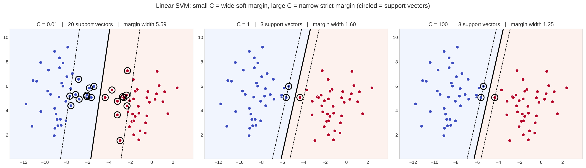

| C | Support vectors | Margin width |
|---|---|---|
| 0.01 | 20 | 5.59 |
| 1 | 3 | 1.60 |
| 100 | 3 | 1.25 |

## 🪄 The Kernel Trick
A linear SVM cannot separate a ring from its centre; the kernel trick lets it learn curved boundaries **without computing the high-dimensional mapping**.

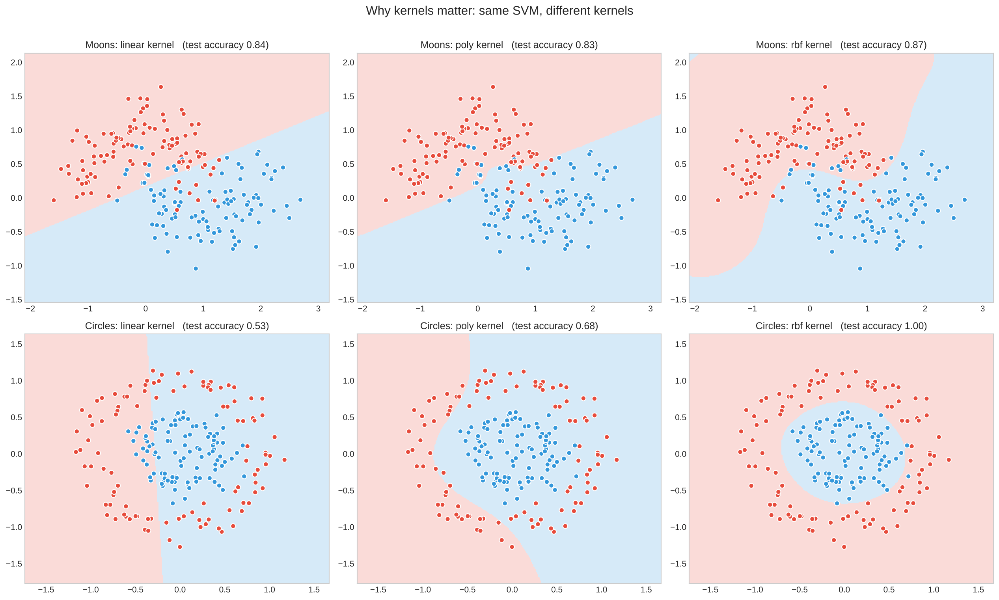

| Dataset | Linear | Polynomial | RBF |
|---|---|---|---|
| Moons | 0.844 | 0.833 | 0.867 |
| Circles | 0.533 | 0.678 | **1.000** |

## 📥 The Digits Data
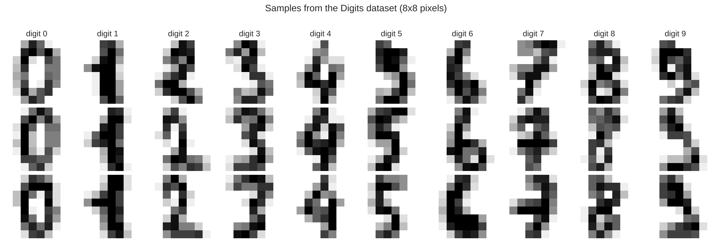

1,797 blurry 8×8 images, pixel values 0 to 16, no missing values, 10 balanced classes (174 to 183 per digit). Split: **1,437 train / 360 test** (stratified).

## 📏 Does Scaling Help? (a surprising answer)
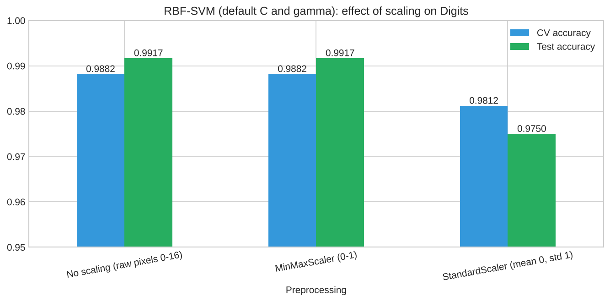

| Preprocessing | CV accuracy | Test accuracy |
|---|---|---|
| No scaling (raw 0 to 16) | 0.9882 | 0.9917 |
| MinMaxScaler | 0.9882 | 0.9917 |
| StandardScaler | 0.9812 | 0.9750 |

All 64 features are pixel intensities on the **same scale**, and standardizing stretches nearly-constant border pixels (mostly noise) to unit variance. The right scaling depends on the data, so **MinMaxScaler inside a Pipeline** is used (fitted on training data only).

## 🔧 Tuning `C` and `gamma` Together
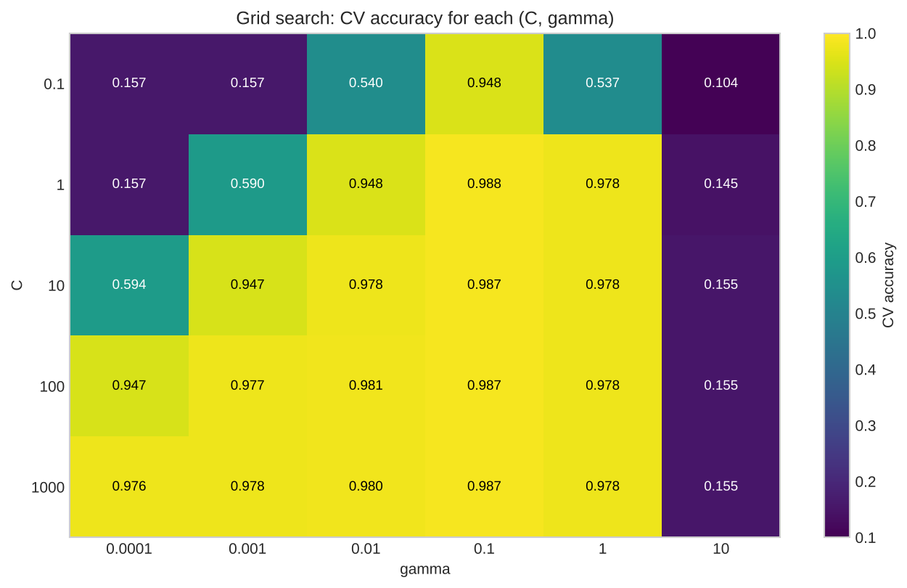

Best: **C = 1, gamma = 0.1** (CV **0.9882**). A diagonal ridge of good values appears: small gamma needs large C and vice versa. **gamma = 10** collapses to ≈ 0.15 (every point only "sees" itself), and **small gamma with small C** underfits.

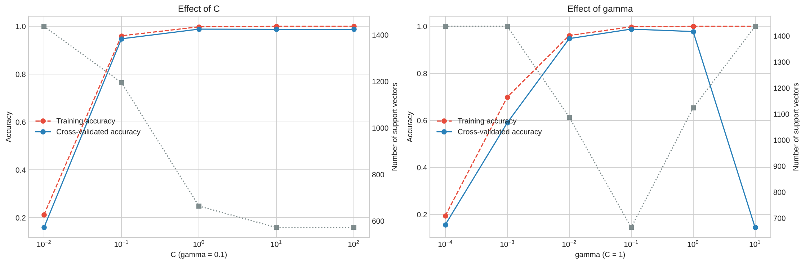

| gamma (C = 1) | Train | CV | Support vectors |
|---|---|---|---|
| 0.01 | 0.961 | 0.948 | 1,088 |
| **0.1** | **0.998** | **0.988** | **664** |
| 1 | 1.000 | 0.978 | 1,123 |
| 10 | 1.000 | 0.145 | 1,437 |

A good model needs the **fewest support vectors**; both under- and over-fitting use almost every training point.

## 🔀 Kernel Comparison (each tuned over C)
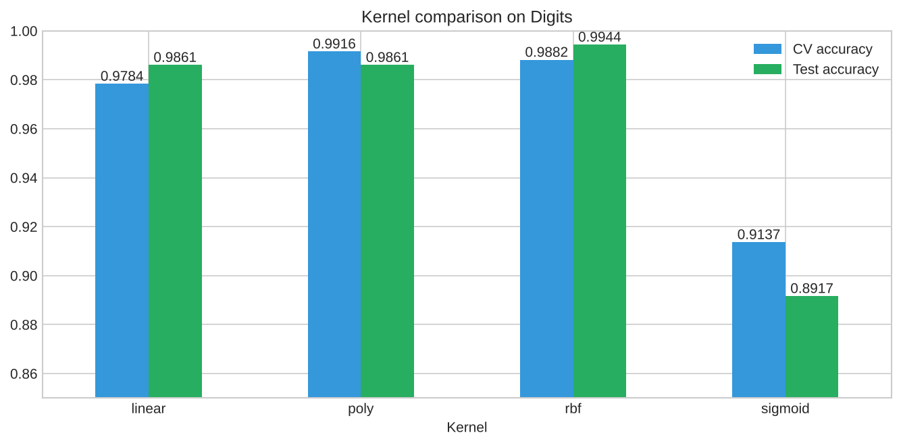

| Kernel | CV accuracy | Test accuracy |
|---|---|---|
| Linear | 0.9784 | 0.9861 |
| Polynomial | 0.9916 | 0.9861 |
| **RBF** | 0.9882 | **0.9944** |
| Sigmoid | 0.9137 | 0.8917 |

The top three differ by about a point (a few images in a 360-image test set), so the ranking should not be over-interpreted.

## 🎯 Final Evaluation
Test accuracy **0.9917** (357 of 360), macro F1 0.992.

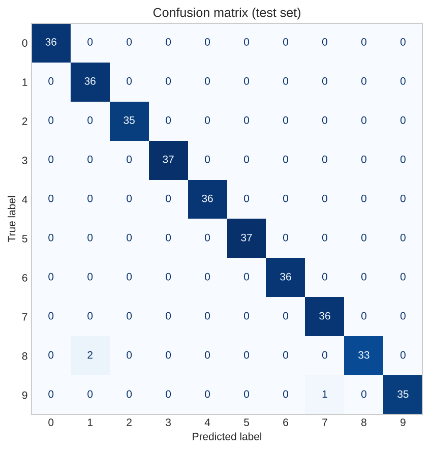
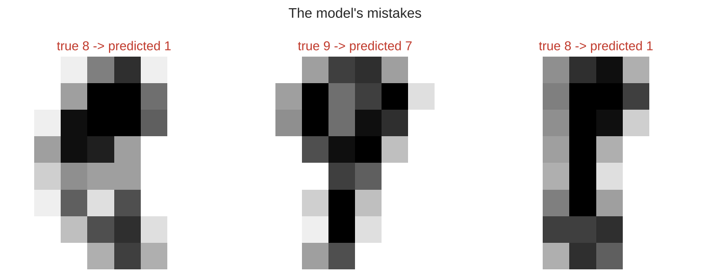

Only **3 mistakes**: two 8s read as 1 and one 9 read as 7, blurry images where this is understandable. With 360 test images a single mistake is 0.28 points, so the CV score (0.988) is the steadier number.

## ⚖️ Comparison with Other Classifiers
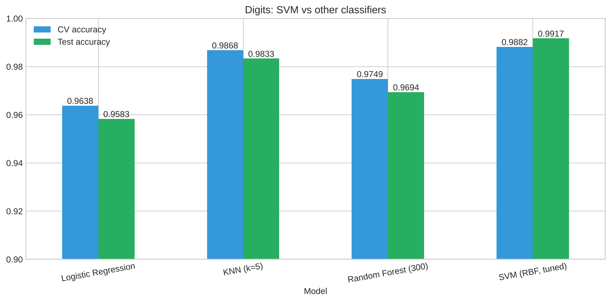

| Model | CV accuracy | Test accuracy |
|---|---|---|
| Logistic Regression | 0.9638 | 0.9583 |
| KNN (k = 5) | 0.9868 | 0.9833 |
| Random Forest (300) | 0.9749 | 0.9694 |
| **SVM (RBF, tuned)** | **0.9882** | **0.9917** |

KNN is within 0.15 points on CV, so the SVM's edge is small. Unlike on a near-linear dataset, a simple linear model does **not** win here: digits have curved class boundaries, which is where kernels help.

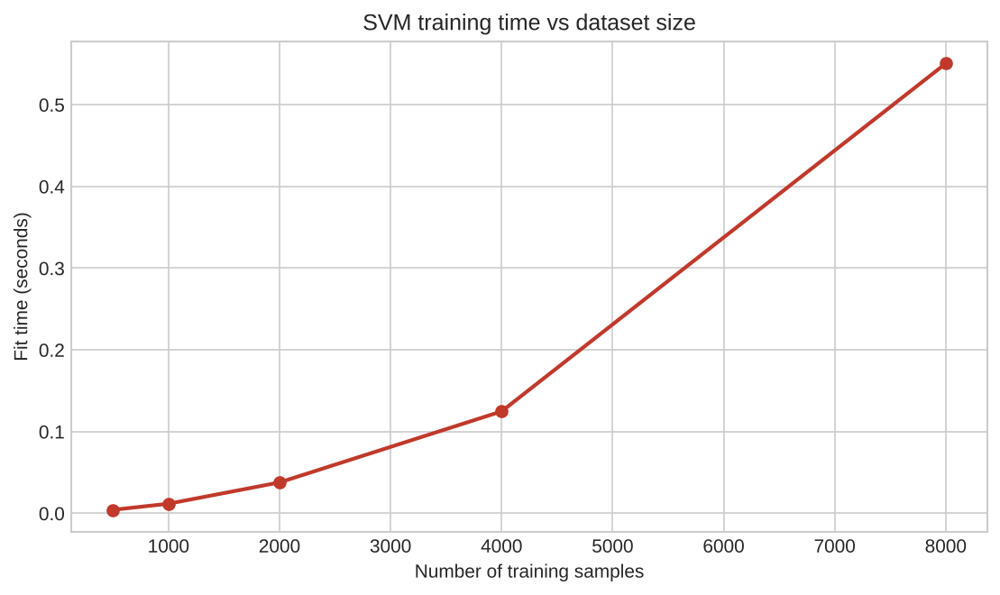

SVM training time grows roughly like **n²** (fitted exponent ≈ 1.7 to 1.8), which is why SVMs suit small and medium datasets and not millions of rows.

## ▶️ How to Run
```bash
git clone https://github.com/D0027/svm-digit-recognition.git
cd svm-digit-recognition
pip install -r requirements.txt
jupyter notebook svm_classification.ipynb
```
Also runs on Kaggle: import the notebook and click **Run All** (no dataset to add).

## 🎤 Interview Questions

<details>
<summary><b>1. What is an SVM and what is the margin?</b></summary>

A classifier that finds the hyperplane separating classes with the **maximum margin** (the widest gap between the classes). A larger margin generally means better generalisation.
</details>

<details>
<summary><b>2. What are support vectors?</b></summary>

The training points that lie on or inside the margin. They alone define the boundary: removing any other point changes nothing. Fewer support vectors means a simpler model (here 664 of 1,437).
</details>

<details>
<summary><b>3. Hard margin vs soft margin, and what does C do?</b></summary>

A hard margin allows no violations (only works for perfectly separable data). A soft margin allows some, with penalty C: **small C** = wide margin, more tolerance (underfit risk); **large C** = narrow margin, few violations (overfit risk).
</details>

<details>
<summary><b>4. What is the kernel trick?</b></summary>

Computing inner products in a high-dimensional feature space through a kernel function K(x, x') without ever building that space, so non-linear boundaries become cheap. Common kernels: linear, polynomial, RBF, sigmoid.
</details>

<details>
<summary><b>5. What does gamma do in the RBF kernel?</b></summary>

It sets how far a single point's influence reaches. **Small gamma** = smooth, broad boundary (underfit); **large gamma** = each point only affects its neighbourhood, with a wiggly boundary (overfit: train 1.00, CV 0.15 at gamma = 10).
</details>

<details>
<summary><b>6. Why is scaling important for SVM, and when is it not?</b></summary>

Kernels use distances, so large-range features dominate; scaling usually helps. But when all features share one natural scale (pixels), standardizing can amplify noise: on Digits MinMax beat StandardScaler.
</details>

<details>
<summary><b>7. How do you choose the kernel?</b></summary>

Start with RBF (flexible default) and linear (fast, strong when features are many or the data is almost linearly separable); compare with cross-validation, and tune `C` (and `gamma`) together with a grid or random search.
</details>

<details>
<summary><b>8. SVM vs logistic regression?</b></summary>

Logistic regression optimises log-loss and gives calibrated probabilities; SVM maximises the margin (hinge loss) and, with kernels, models non-linear boundaries. SVMs often win on small, high-dimensional data, while logistic regression is faster and easier to interpret.
</details>

<details>
<summary><b>9. How does an SVM handle multiple classes?</b></summary>

It is binary by design; scikit-learn's `SVC` trains one-vs-one classifiers (45 of them for 10 digits) and votes, while `LinearSVC` uses one-vs-rest.
</details>

<details>
<summary><b>10. How do you get probabilities from an SVM?</b></summary>

`SVC(probability=True)` fits a Platt-scaling calibration with extra cross-validation (slower); otherwise use `decision_function` scores (signed distance to the boundary).
</details>

<details>
<summary><b>11. What are the drawbacks of SVMs?</b></summary>

Training time grows roughly between O(n²) and O(n³), memory is heavy for large datasets, results are sensitive to `C`, `gamma` and scaling, and there are no built-in probabilities or feature importances. Use `class_weight='balanced'` for imbalanced data.
</details>

<details>
<summary><b>12. Can SVMs do regression?</b></summary>

Yes: Support Vector Regression (`SVR`) fits a tube of width epsilon around the data and ignores errors inside it.
</details>

## 👤 Author

**Deepak Yadav**

[](https://github.com/D0027)
[](https://linkedin.com/in/deepakyadav027)
[](https://d0027.github.io)
